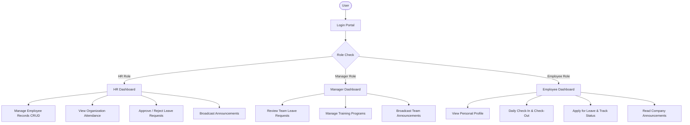

# 🏢 StaffSync — Human Resource Management System (HRMS)

> A modern, full-stack **MERN** (MongoDB, Express.js, React.js, Node.js) web application designed to streamline and automate core human resource operations with role-based access control for **HR Administrators**, **Team Managers**, and **Staff Employees**.

---

## 🌟 Key Highlights & Deliverables
- **Role-Based Access Control (RBAC)**: Dedicated dashboards and granular permissions for HR, Managers, and Employees.
- **MVC Architecture**: Clean separation of Models (Mongoose), Views/Routes (Express), and Controllers with robust error handling.
- **Zero-Config Database**: Seamless dual-mode database engine. Automatically runs on embedded in-memory MongoDB out of the box (zero installation or setup required for testing/grading), while also fully supporting local MongoDB or cloud MongoDB Atlas via `.env`.
- **Pre-Seeded Realistic Demo Data**: Automatically seeds realistic corporate profiles, past attendance logs, leave requests, training programs, and company announcements.
- **One-Click Quick Login**: Login screen includes instant credential pre-fill buttons for HR, Manager, and Employee for grading and demonstrations.
- **100% Tested & Verified**: Automated test suite covering auth, role guards, attendance punches, leave lifecycles, and training operations.

---

## 🛠️ Technology Stack

| Layer | Technologies Used |
| :--- | :--- |
| **Frontend** | React 18, Vite, JavaScript (ES6+), Bootstrap 5, Bootstrap Icons, Axios, React Router DOM v6 |
| **Backend** | Node.js, Express.js (MVC Pattern), CORS, Dotenv |
| **Database** | MongoDB, Mongoose ODM (with automated zero-config in-memory fallback) |
| **Security** | JSON Web Tokens (JWT), Bcrypt.js salted password hashing, Role Middleware |

---

## 👥 Roles & Responsibilities



### 1. 🛡️ HR Administrator (`/hr`)
- **Workforce Directory**: Add new employee records (with auto-generated login credentials), view employee list with real-time search and department filtering, edit employee records, and delete records.
- **Attendance Monitoring**: Inspect daily check-in/check-out logs across all departments with calendar date and status filtering.
- **Leave Decisioning**: Review submitted employee leave requests, approve or reject applications, and provide transparent written feedback.
- **Company Announcements**: Post company-wide broadcast notices, holidays, and policy updates with target audience selection.
- **Department Metrics**: View real-time visual progress bars of employee distribution across Engineering, HR, Marketing, Finance, and Operations.

### 2. 💼 Team Manager (`/manager`)
- **Leave Approvals**: Review pending leave applications from team members, examine dates and reasons, and approve or reject with comments.
- **Training & Skill Development**: Create new corporate training workshops, assign instructors, enroll employees, monitor progress percentages, and transition program statuses (*Upcoming*, *Ongoing*, *Completed*).
- **Team Communications**: Publish department announcements and team updates to the company notice board.
- **Team Stats**: High-level overview of team attendance and ongoing training initiatives.

### 3. 👤 Staff Employee (`/employee`)
- **Self-Service Profile**: View personal personnel records including Employee ID, Department, Designation, Email, Phone, Joining Date, and Status.
- **Daily Attendance Punch**: Record real-time **Check-In** and **Check-Out** timestamps with attendance modes (*Present*, *Work From Home*, *Half-day*) and optional notes.
- **Personal Attendance History**: Complete tabular log of past attendance records and timestamps.
- **Leave Application**: Submit leave applications (*Casual Leave*, *Sick Leave*, *Paid Leave*, *Emergency Leave*) with date pickers and reason inputs.
- **Leave Status Tracking**: View real-time status badges (*Pending*, *Approved*, *Rejected*) and reviewer comments.
- **Company Feed & Training**: Read announcements and track enrolled training progress.

---

## 🔑 Demo Login Credentials

The login screen (`http://localhost:3000/login`) features **1-Click Quick Fill buttons** for effortless testing. You can also manually type:

| Role | Email Address | Password | Sample Persona |
| :--- | :--- | :--- | :--- |
| **HR Administrator** | `hr@staffsync.com` | `Password123!` | Sarah Jenkins (Senior HR Director) |
| **Team Manager** | `manager@staffsync.com` | `Password123!` | Michael Chang (Engineering Lead) |
| **Team Manager 2** | `manager2@staffsync.com` | `Password123!` | Elena Rostova (Marketing Director) |
| **Staff Employee** | `employee@staffsync.com` | `Password123!` | Alex Rivera (Frontend Developer) |
| **Staff Employee 2** | `priya.sharma@staffsync.com` | `Password123!` | Priya Sharma (Cloud Developer) |
| **Staff Employee 3** | `david.kim@staffsync.com` | `Password123!` | David Kim (Growth Specialist) |
| **Staff Employee 4** | `ananya.patel@staffsync.com` | `Password123!` | Ananya Patel (Financial Analyst) |

---

## 🚀 Quick Start Guide

### Option A: One-Click Windows Launcher (Easiest)
1. Double-click the file **`start_staffsync.bat`** located in the project root folder.
2. It will automatically launch the Backend Server (Port 5000), launch the Frontend Client (Port 3000), and prompt you to open the browser at **`http://localhost:3000`**.

---

### Option B: Standard Terminal Commands

#### 1. Start the Backend API Server
Open a terminal in the project folder:
```bash
cd server
npm start
```
*The server will start on `http://localhost:5000` and automatically initialize the database with pre-seeded data.*

#### 2. Start the Frontend Application
Open a second terminal:
```bash
cd client
npm run dev
```
*The Vite development server will open on `http://localhost:3000`.*

---

## 🧪 Running the Automated Verification Suite

StaffSync includes an end-to-end API test script that validates the entire backend workflow:
```bash
cd server
node test_api.js
```
*(Or double-click **`run_tests.bat`**)*

**Test Coverage Verified:**
- Health check endpoint (`200 OK`)
- HR, Manager, and Employee JWT authentication and token verification
- Invalid credential rejection (`401 Unauthorized`)
- HR aggregated statistics and Employee CRUD operations
- Role-based route guard enforcement (blocking unauthorized roles with `403 Forbidden`)
- Daily attendance punch in/out workflow
- Leave application and manager approval cycle
- Training program creation and announcement broadcast

---

## 🗄️ Database Architecture & Collections

StaffSync implements 6 core Mongoose models:
1. **`User`**: Account authentication (`name`, `email`, `password` [bcrypt hash], `role` ['hr', 'manager', 'employee'], `employee` [ref: Employee]).
2. **`Employee`**: Personnel record (`employeeId`, `firstName`, `lastName`, `email`, `phone`, `department`, `designation`, `salary`, `dateOfJoining`, `status`).
3. **`LeaveRequest`**: Leave tracking (`employee`, `leaveType`, `startDate`, `endDate`, `reason`, `status` ['Pending', 'Approved', 'Rejected'], `reviewedBy`, `reviewComments`).
4. **`Attendance`**: Daily time logs (`employee`, `date`, `checkIn`, `checkOut`, `status` ['Present', 'Absent', 'Half-day', 'Work From Home'], `notes`).
5. **`Announcement`**: Organization notices (`title`, `content`, `category`, `targetAudience`, `postedBy`, `postedByName`).
6. **`TrainingProgram`**: Skill initiatives (`title`, `description`, `trainer`, `department`, `startDate`, `endDate`, `status`, `participants`).

---

## 📡 REST API Reference

### Authentication (`/api/auth`)
- `POST /api/auth/login`: Authenticate user and return JWT token.
- `POST /api/auth/register`: Create user account.
- `GET  /api/auth/me`: Retrieve current logged-in user profile.

### Employees (`/api/employees`)
- `GET    /api/employees`: List employees with optional department/search filter *(HR, Manager)*.
- `GET    /api/employees/:id`: Retrieve single employee details.
- `POST   /api/employees`: Create new employee record *(HR only)*.
- `PUT    /api/employees/:id`: Update employee record *(HR, Manager)*.
- `DELETE /api/employees/:id`: Remove employee and associated user account *(HR only)*.

### Attendance (`/api/attendance`)
- `POST /api/attendance/check-in`: Record today's check-in timestamp.
- `POST /api/attendance/check-out`: Record today's check-out timestamp.
- `GET  /api/attendance/my`: Get current employee's attendance logs.
- `GET  /api/attendance`: View workforce attendance logs *(HR, Manager)*.
- `POST /api/attendance/admin-mark`: Override or mark attendance record *(HR only)*.

### Leave Management (`/api/leaves`)
- `POST /api/leaves`: Apply for leave.
- `GET  /api/leaves/my`: View current employee's leave applications.
- `GET  /api/leaves`: View all leave requests *(HR, Manager)*.
- `PUT  /api/leaves/:id/status`: Approve or reject leave request *(HR, Manager)*.

### Training & Announcements (`/api/training`, `/api/announcements`, `/api/stats`)
- `GET  /api/training`: List training programs.
- `POST /api/training`: Create training program *(Manager, HR)*.
- `POST /api/training/:id/enroll`: Enroll employee into program.
- `GET  /api/announcements`: List company announcements.
- `POST /api/announcements`: Broadcast new announcement *(HR, Manager)*.
- `GET  /api/stats/dashboard`: Aggregated dashboard metrics.

---

## ⚙️ Environment Configuration

Backend configuration is stored in `server/.env`:
```env
PORT=5000
MONGO_URI=mongodb://127.0.0.1:27017/staffsync
JWT_SECRET=staffsync_super_secret_jwt_key_college_project_2026
JWT_EXPIRES_IN=7d
NODE_ENV=development
```

> **Note on MongoDB**: If you do not have a local MongoDB daemon installed on your computer, StaffSync will automatically launch an embedded in-memory MongoDB instance. You do not need to install MongoDB to run or grade this project. If you wish to connect to MongoDB Atlas, simply replace `MONGO_URI` with your connection string.

---

## ❓ Troubleshooting & FAQs

- **Port 5000 or 3000 already in use**:
  If another process is using port 5000 or 3000, you can edit `PORT=5001` in `server/.env` and `port: 3001` in `client/vite.config.js`.
- **Resetting Demo Data**:
  To reset all collections back to original demo values, run:
  ```bash
  cd server
  npm run seed
  ```
- **Session Expiration**:
  If your JWT token expires, simply click "Logout" in the top navigation bar and log in again using the demo buttons.
